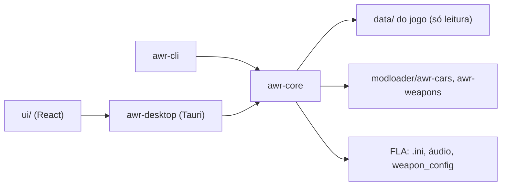

<div align="center">


# SA-AWR — Add Without Replace

*Ferramenta desktop em Rust para adicionar carros e armas ao GTA San Andreas sem substituir nada do jogo original.*

</div>

<p align="center">
  <a href="https://github.com/josemurilors/SAAWR/actions/workflows/ci.yml"></a>
  
  
  
  
</p>

| | |
| --- | --- |
| **Versão** | 0.1.0 (v2, reescrita do zero) |
| **Estado** | Veículos (carro, moto, barco, avião) e armas (pistola, fuzil, corpo a corpo) prontos e testados no jogo, com CLI e interface; release e polimento pendentes |
| **Contexto** | Projeto pessoal; segue os tutoriais MixMods de carros e armas sem substituir |
| **Alvo** | Windows, GTA SA 1.0 US com ModLoader + fastman92 Limit Adjuster + Open Limit Adjuster |

> **Ele escreve no jogo.** Injetar, ligar/desligar e remover mexem em arquivos da pasta `modloader` e do FLA (com `.bak` do original). Use sempre uma cópia da pasta do jogo enquanto o projeto é jovem.

## Sumário

- [Início rápido](#início-rápido)
- [1. Objetivo](#1-objetivo)
- [2. Princípios](#2-princípios)
- [3. Arquitetura](#3-arquitetura)
- [4. Estrutura do repositório](#4-estrutura-do-repositório)
- [5. Regras do FLA e do OLA](#5-regras-do-fla-e-do-ola)
- [6. Integridade dos arquivos do jogo](#6-integridade-dos-arquivos-do-jogo)
- [7. Desenvolvimento e execução local](#7-desenvolvimento-e-execução-local)
- [8. Critérios de aceite](#8-critérios-de-aceite)
- [9. Limites de escopo e evolução](#9-limites-de-escopo-e-evolução)
- [10. Documentação complementar](#10-documentação-complementar)
- [11. Créditos e referências](#11-créditos-e-referências)
- [12. Autor e licença](#12-autor-e-licença)

## Início rápido

```bash
git clone https://github.com/josemurilors/SAAWR.git && cd SAAWR
scripts/fixtures.sh "/d/Games/GTA San Andreas"   # fixtures do jogo, só locais
cargo test --all
cargo run -p awr-cli -- status --gta "D:\Games\GTA San Andreas"
npm --prefix ui ci && npm --prefix ui run build   # interface (React)
cargo run -p awr-desktop --release                # abre o app: solte a pasta do mod na janela
```

## 1. Objetivo

O SA-AWR automatiza o método "adicionar sem substituir" dos tutoriais MixMods. O jogador escolhe um `.dff` + `.txd`, um nome e um veículo de referência. A ferramenta cuida do resto: ID livre, linhas de handling, IDE e carcols, tráfego, áudio e limites do FLA. Tudo fica em pastas próprias do ModLoader, que podem ser desativadas ou apagadas sem deixar resíduo.

**Não faz:** substituir modelos originais, editar handling campo a campo, gerenciar mods de terceiros, nem acessar a rede.

### Entregas desta versão

- Detecção da instalação: jogo, ModLoader, FLA e OLA, na raiz ou dentro do modloader.
- Inventário lido do disco: pastas `{id}-{short}`; pasta com prefixo `. ` = desativada; pasta sem `meta.json` = mod de terceiro.
- Sync do `.ini` do FLA byte a byte, com teste golden contra o `.ini` oficial.
- 212 veículos de referência lidos dos arquivos originais do jogo.
- Alocação de IDs, clonagem das linhas de handling/IDE/carcols/fxt, cargrp e áudio.
- **Injeção de veículos** (carro, moto, barco, avião): pasta própria em `modloader/awr-cars`, injeção atômica, ligar/desligar, remover e reparar sem resíduo.
- **Pacote completo:** peças de tuning (renomeadas `{peça}_{short}`, com IDs próprios e linhas `carmods`/IDE), paintjobs (`{ref}N.txd` vira `{short}N.txd`) e cores do ImVehFt (`vehicle_id` trocado).
- **Handling e cores do pacote:** se o readme traz a linha de handling (e a `!`/`%`/`$` de moto, barco e avião), ela é usada no lugar da cópia da referência, o mesmo vale para a linha de cores (`carcols`) da mesma readme; dá para desligar na interface (`--no-pack-handling` na CLI).
- **Tráfego à escolha:** como a referência, nenhum, ou um dos grupos do `cargrp.dat`.
- **Lote:** uma pasta com subpastas vira uma fila; o nome vem da pasta e a referência do nome do `.dff` (`sanchez.dff` sugere `sanchez`).
- **Checker:** bloqueia a injeção sem ModLoader, FLA ou OLA e avisa de `cargrp.dat` duplicado, limites do OLA ativos no `.ini` e jogo aberto.
- **Armas:** o nome informado fica no `meta.json` (sem nome, vale o nome curto); pasta própria em `modloader/awr-weapons` com o `.ide`, o `Loader.txt` (linhas de `weapon.dat` e `object.dat` clonadas da arma de referência, ou as do readme do pacote; `--no-pack-lines` desliga) e, no FLA, a linha do `gtasa_weapon_config.dat` com um tipo de arma novo (a partir de 70). As texturas de HUD (`*icon`, `*crosshair`) do `.txd` são renomeadas para a nova arma.
- **Scripts CLEO do pacote:** a pasta `CLEO` do pacote (`.cs` ou `.cleo`) pode ser copiada, de forma opcional, para a pasta do mod, em veículos e armas (caixa na interface, `--cleo` na CLI).
- **Som da arma:** dá para herdar som e comportamento de outra arma (campo "Som e comportamento iguais a" na interface, `--sound-like` na CLI) em vez da referência; sons próprios (WAVs) ainda não, veja [docs/AUDIO.md](docs/AUDIO.md).
- **Adotar pasta sem `meta.json`:** `awr-cli adopt <pasta>` refaz o registro de um carro ou arma que já está em `awr-cars`/`awr-weapons` (lê o `.ide`/`linhas.txt`, o áudio, o tráfego e a linha do `weapon_config`) para que a ferramenta volte a ligar, editar e remover. Sem `--yes` só mostra o que seria gravado; carros pedem `--ref`. Não mexe nos arquivos do jogo, não reconhece peças de tuning e só vale para essas duas pastas (mods soltos no ModLoader continuam intocados). Só CLI por enquanto.
- **Restaurar originais:** apaga todos os mods do AWR e devolve o `.ini` do FLA, o áudio e o `weapon_config` aos `.bak` guardados na primeira alteração (o do trainer só perde o bloco do AWR). Botão na interface, com confirmação, e `restore --yes` na CLI. Edições feitas à mão nesses arquivos depois do primeiro `.bak` também voltam ao original.
- **RZL-Trainer:** se existir `CLEO/RZL-Trainer/Add-on Weapons.ini`, as armas ligadas entram nele (bloco `; AWR-BEGIN`/`; AWR-END`, com o tipo da arma e o nome); entradas feitas à mão não são tocadas.
- **Editar o que já está instalado:** nome no jogo, tráfego e som do motor dos veículos, e o nome das armas, direto no painel lateral da aba Instalados. As linhas globais (áudio e tráfego) são refeitas na hora se o item estiver ligado; se estiver desligado, valem na próxima vez que ligar.
- **Identidade visual:** o ID de cada item aparece como uma placa da Califórnia (branca e azul para veículos, amarela para o tipo da arma), com tipografia Barlow e Big Shoulders Display (empacotadas, sem internet) e verde de placa de rodovia nas ações.
- **Nome no jogo:** o HUD não tem acentos nem aceita `~` (códigos de cor), então o nome é ajustado para ASCII seguro (até 24 caracteres) e a interface mostra como vai aparecer. O nome curto é sugerido a partir do nome, sem repetir nenhum já usado.
- **Armas especiais:** pistola com silenciador, jetpack e binóculos (este último experimental, sem teste no jogo). Cada tipo de arma tem seu ícone (corpo a corpo, pistola, submetralhadora, escopeta, fuzil, sniper, lançador, arremesso, arma pesada, spray e equipamento).
- **CLI** (`status`, `doctor`, `groups`, `weapons`, `inject`, `inject-weapon`, `batch`, `enable`, `disable`, `remove`, `repair`, `restore`, `adopt`) e **interface** (Tauri + React) com abas Importar/Instalados.

## 2. Princípios

1. **Núcleo em Rust, interface em React:** toda a regra de negócio fica no `awr-core`; a interface é uma casca fina (Tauri 2 + React) que só chama comandos. Roda no WebView2 do Windows 11. O app egui antigo (`awr-app`) continua no repositório até a interface nova ser aprovada.
2. **Disco como fonte da verdade:** cada mod tem um `meta.json`; o inventário é refeito por varredura, sem banco paralelo.
3. **Bytes, não strings:** arquivos do jogo são CRLF + Windows-1252; a ferramenta troca só os tokens que precisa e preserva o resto byte a byte.
4. **Core sem GUI:** `awr-core` é testável sozinho; a CLI e a interface usam o mesmo core.

## 3. Arquitetura



**Leitura:** `paths` detecta a instalação, `references` lê os veículos originais e `inventory` lista os mods. **Escrita** (`injector`): monta a pasta em `modloader/. awr-staging`, edita os arquivos globais (áudio e `.ini` do FLA, com `.bak`; tráfego numa cópia do `cargrp.dat` em `awr-transito`) e promove a pasta com um rename. Uma queda no meio deixa só linhas órfãs e o staging, que o `repair` limpa.

### Stack

| Área | Escolha | Papel |
| --- | --- | --- |
| Linguagem | Rust (edição 2021) | Core, CLI e interface |
| Interface | Tauri 2 + React 19 + Vite (TypeScript) | Janela com abas, drag-and-drop de pastas, seletor nativo; fontes Barlow e Big Shoulders empacotadas |
| Interface antiga | `eframe`/`egui` + `rfd` | `awr-app`, mantida por enquanto |
| Encoding | `encoding_rs` | Windows-1252 dos arquivos do jogo |
| Erros | `thiserror` | `AwrError` por domínio |
| Estado | `serde` + `serde_json` | `meta.json` e configuração |
| Config | `directories` | Pasta de configuração do usuário |
| Testes | `tempfile` + fixtures golden | Comparação byte a byte |
| CI | GitHub Actions (Windows) | `fmt`, `clippy -D warnings`, `test` |

## 4. Estrutura do repositório

```text
SAAWR/
├── crates/
│   ├── awr-core/src/   # lógica: injector, weapons, checker, batch, pack, readme, tuning, fla, references, ids…
│   ├── awr-cli/src/    # binário `awr-cli`
│   ├── awr-app/src/    # interface egui antiga (`awr-app`)
│   └── awr-desktop/    # casca Tauri: comandos sobre o core (`awr-desktop`)
├── ui/                 # front end React + Vite + TypeScript
├── fixtures/           # poisoned_cp1252.ini versionado; arquivos do jogo só locais
├── scripts/fixtures.sh # copia as fixtures da sua instalação do GTA SA
├── docs/               # escopo (spec) e plano de desenvolvimento
└── .github/workflows/  # CI
```

## 5. Regras do FLA e do OLA

- **O OLA é obrigatório.** Sem ele, a injeção é bloqueada.
- **`Vehicle Models` e `Weapon Models` nunca são tocadas** e ficam com `#`, como mandam os tutoriais: "Se você usa Open Limit Adjuster, NÃO EDITE ESTA LINHA!".
- As chaves que os tutoriais mandam editar perdem o `#` e recebem o valor calculado. Todas as outras ficam idênticas.
- Os limites só crescem. `Count of killable model IDs` = maior ID + 16, arredondado para cima a múltiplo de 50. As contagens respeitam os pisos do tutorial (standard lines ≥ 300).
- **Confirmado no jogo:** só o OLA não basta para o handling (o `handling.cfg` original já usa as 210 linhas e o carro novo nasce voando), então o sync liga `Apply handling.cfg patch`. Já `Apply ID limit patch` e `Enable model special feature loader` **não são geridos**: o special feature loader derrubou o jogo junto do OLA.
- IDs: carros a partir de 12500; armas de 12400 a 12499; o menor ID livre vence; mods desativados mantêm o ID reservado.

## 6. Integridade dos arquivos do jogo

- **Escrita atômica:** arquivo temporário na mesma pasta + rename.
- **`.bak`:** guarda sempre o original de antes da ferramenta, nunca a última edição.
- **Arquivos originais em `data\`** são só lidos.
- **Golden tests** comparam `Vec<u8>`, então mudanças de CRLF ou de encoding fazem o teste falhar.

Os testes não substituem o teste no jogo. O formato de pasta do ModLoader, o handling, o áudio clonado, as peças de tuning, as paintjobs e o tráfego foram confirmados no jogo numa cópia da instalação (spike do [plano](docs/PLANO.md)).

## 7. Desenvolvimento e execução local

### Pré-requisitos

- Rust estável ≥ 1.80 (testado com 1.99) e Git Bash, para o script de fixtures.
- Uma instalação do GTA SA com ModLoader, FLA (com o `fastman92limitAdjuster_GTASA.ini` oficial ao lado do `.asi`) e OLA.

### Passo a passo

1. Gere as fixtures locais: `scripts/fixtures.sh "/d/Games/GTA San Andreas"`.
2. Rode os testes: `cargo test --all`.
3. Veja o diagnóstico da sua instalação: `cargo run -p awr-cli -- doctor --gta "D:\Games\GTA San Andreas"`.
4. Abra a interface: `npm --prefix ui ci && npm --prefix ui run build`, depois `cargo run -p awr-desktop --release`. Informe a pasta do jogo no botão "GTA SA" e solte a pasta do mod na janela. Para mexer só no visual, `npm --prefix ui run dev` abre `http://localhost:1420` no navegador com dados de exemplo.
5. Ou use a CLI: `awr-cli inject --name "VW New Beetle" --ref uranus --pack "<pasta do mod>" --gta "<jogo>"` (ou `batch <pasta>` para vários; sem `--yes` só simula).

Carros de packs com recursos do ImVehFt/VehFuncs (rodas variáveis, luzes) precisam desses plugins instalados no jogo.

**Armas:** trainers e scripts usam o **tipo** da arma (70, 71, …), não o ID do modelo (12400, …). Dar o ID do modelo como tipo derruba o jogo. O inventário mostra o tipo de cada arma instalada. Ex.: `awr-cli inject-weapon --name "Luger P08" --short luger --ref PISTOL --pack "<pasta>" --gta "<jogo>"`.

### Testes

```bash
cargo fmt --all --check
cargo clippy --all-targets -- -D warnings
cargo test --all
```

Sem as fixtures do jogo (como na CI), os testes que dependem delas avisam "pulado" e passam; um teste com instalação sintética (carro inventado) roda sempre e cobre injetar, desligar, remover e restaurar. Rode o script localmente para cobrir tudo.

## 8. Critérios de aceite

- [x] Fase 0: `awr-cli status` detecta ModLoader, FLA e OLA numa instalação real.
- [x] Sync do FLA byte a byte, sem tocar nas chaves do OLA.
- [x] Referências, IDs, clonagem de linhas, cargrp e áudio com testes contra os arquivos reais.
- [x] Teste no jogo do formato de pasta do ModLoader (carro, moto, barco e avião).
- [x] Injector (injetar, desativar, remover, reparar) + CLI.
- [x] Fase 1: 4 veículos reais injetados e removidos numa cópia do jogo, sem resíduo; `data\` idêntico ao original.
- [x] Pacote com peças de tuning, paintjobs e cores IVF funcionando no jogo.
- [x] Fase 2: interface (importar, lote, tráfego, inventário, health) em egui e, agora, em Tauri + React.
- [x] Fase 3: armas (pistola, fuzil e arma branca) injetadas, testadas no jogo e removidas sem resíduo; o `gtasa_weapon_config.dat` volta idêntico ao `.bak`.
- [x] Fase 4: release `.exe` portable (v0.1.0); a CI publica o `.zip` sozinha ao enviar uma tag `v*`.

## 9. Limites de escopo e evolução

**Dentro:** carros, motos, barcos, aeronaves e armas novos via ModLoader, com peças de tuning, paintjobs e cores IVF do pacote (renomeadas para o carro). **Fora:** edição de handling campo a campo, múltiplos perfis do ModLoader, Android, telemetria e rede. **Pendências conhecidas:** testar no jogo os binóculos e o jetpack; carcols do pacote só valem quando a mesma readme traz o handling, e só se o formato (pares ou quádruplas) combinar com o da referência; áudio "silencioso" (carro sem linha de áudio testado no jogo e funciona); scripts CLEO fora de uma pasta `CLEO` (soltos na raiz do pacote); **Evoluções possíveis:** sons próprios de arma via EarShot (a testar no jogo); adotar mods de terceiros soltos no ModLoader (hoje só pastas de `awr-cars`/`awr-weapons`) e botão de adotar na interface; interface em inglês (a interface e as mensagens de erro estão em português, fixas no código).

## 10. Documentação complementar

- [docs/ESCOPO.md](docs/ESCOPO.md): especificação completa (arquitetura, formatos de arquivo, contrato da API, fontes).
- [docs/PLANO.md](docs/PLANO.md): plano de desenvolvimento por fases, com o resultado do spike no jogo.
- [docs/AUDIO.md](docs/AUDIO.md): áudio de armas (o que já existe e o plano para sons próprios com o EarShot).
- [docs/UI.md](docs/UI.md): plano do redesign da interface (identidade visual já aplicada; o documento ainda marca como proposta).
- Tutoriais seguidos: [carros](https://www.mixmods.com.br/2020/02/tutorial-adicionar-carros-sem-substituir/) e [armas](https://www.mixmods.com.br/2019/02/tutorial-adicionar-armas-sem-substituir/) sem substituir (MixMods).

## 11. Créditos e referências

O SA-AWR não inclui nem distribui nenhum destes mods; ele automatiza a configuração deles seguindo os tutoriais do MixMods.

| Projeto | Autoria | Referência |
| --- | --- | --- |
| SA Essentials Pack (ModLoader, CLEO e outros mods essenciais) | Pacote organizado por Junior_Djjr (MixMods); o Widescreen Fix é de ThirteenAG | [mixmods.com.br](https://www.mixmods.com.br/2019/06/sa-essentials-pack/) |
| Open Limit Adjuster (OLA) | LINK/2012, ThirteenAG e Blackbird88 | [mixmods.com.br](https://www.mixmods.com.br/2022/10/open-limit-adjuster/) |
| fastman92 Limit Adjuster (FLA) | fastman92 | [mixmods.com.br](https://www.mixmods.com.br/2022/01/fastman92-limit-adjuster/) |

## 12. Autor e licença

| Nome | Papel | GitHub |
| --- | --- | --- |
| José Murilo R. Sabalo | Autor | [@josemurilors](https://github.com/josemurilors) |

Licença [MIT](LICENSE). GTA San Andreas é marca da Rockstar Games; nenhum arquivo do jogo é distribuído neste repositório.
