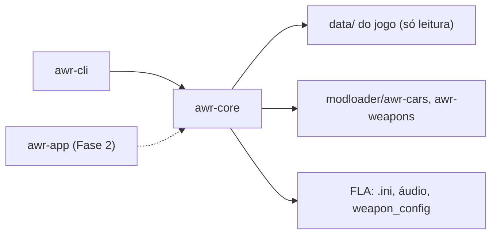

<div align="center">

# SA-AWR — Add Without Replace

*Ferramenta desktop em Rust para adicionar carros e armas ao GTA San Andreas sem substituir nada do jogo original.*

</div>

<p align="center">
  <a href="https://github.com/josemurilors/SAAWR/actions/workflows/ci.yml"></a>
  
  
  
  
</p>

| | |
| --- | --- |
| **Versão** | 0.1.0 (v2, reescrita do zero) |
| **Estado** | Fase 1 concluída (veículos: carro, moto, barco e avião testados no jogo); interface e armas pendentes |
| **Contexto** | Projeto pessoal; segue os tutoriais MixMods de carros e armas sem substituir |
| **Alvo** | Windows, GTA SA 1.0 US com ModLoader + fastman92 Limit Adjuster + Open Limit Adjuster |

> **Ainda não instala mods.** Hoje só a CLI `status` existe: ela detecta a instalação e lista o inventário, sem escrever nada no jogo. Teste sempre numa cópia da pasta do jogo.

## Sumário

- [Início rápido](#início-rápido)
- [1. Objetivo](#1-objetivo)
- [2. Princípios](#2-princípios)
- [3. Arquitetura](#3-arquitetura)
- [4. Estrutura do repositório](#4-estrutura-do-repositório)
- [5. Regras do FLA e do OLA](#5-regras-do-fla-e-do-ola)
- [6. Integridade dos arquivos do jogo](#6-integridade-dos-arquivos-do-jogo)
- [7. Desenvolvimento e execução local](#7-desenvolvimento-e-execução-local)
- [8. Critérios de aceite](#8-critérios-de-aceite)
- [9. Limites de escopo e evolução](#9-limites-de-escopo-e-evolução)
- [10. Documentação complementar](#10-documentação-complementar)
- [11. Autor e licença](#11-autor-e-licença)

## Início rápido

```bash
git clone https://github.com/josemurilors/SAAWR.git && cd SAAWR
scripts/fixtures.sh "/d/Games/GTA San Andreas"   # fixtures do jogo, só locais
cargo test --all
cargo run -p awr-cli -- status --gta "D:\Games\GTA San Andreas"
```

## 1. Objetivo

O SA-AWR automatiza o método "adicionar sem substituir" dos tutoriais MixMods. O jogador escolhe um `.dff` + `.txd`, um nome e um veículo de referência. A ferramenta cuida do resto: ID livre, linhas de handling, IDE e carcols, tráfego, áudio e limites do FLA. Tudo fica em pastas próprias do ModLoader, que podem ser desativadas ou apagadas sem deixar resíduo.

**Não faz:** substituir modelos originais, editar handling campo a campo, gerenciar mods de terceiros, nem acessar a rede.

### Entregas desta versão

- Detecção da instalação: jogo, ModLoader, FLA e OLA, na raiz ou dentro do modloader.
- Inventário lido do disco: pastas `{id}-{short}`; pasta com prefixo `. ` = desativada; pasta sem `meta.json` = mod de terceiro.
- Sync do `.ini` do FLA byte a byte, com teste golden contra o `.ini` oficial.
- 212 veículos de referência lidos dos arquivos originais do jogo.
- Alocação de IDs, clonagem das linhas de handling/IDE/carcols/fxt, cargrp e áudio.

## 2. Princípios

1. **100% Rust:** interface nativa (egui na Fase 2), sem WebView.
2. **Disco como fonte da verdade:** cada mod tem um `meta.json`; o inventário é refeito por varredura, sem banco paralelo.
3. **Bytes, não strings:** arquivos do jogo são CRLF + Windows-1252; a ferramenta troca só os tokens que precisa e preserva o resto byte a byte.
4. **Core sem GUI:** `awr-core` é testável sozinho; a CLI e a interface usam o mesmo core.

## 3. Arquitetura



**Leitura:** `paths` detecta a instalação, `references` lê os veículos originais e `inventory` lista os mods. **Escrita** (injector, pendente): monta a pasta em staging, edita os arquivos globais com `.bak` e promove a pasta com um rename.

### Stack

| Área | Escolha | Papel |
| --- | --- | --- |
| Linguagem | Rust (edição 2021) | Core e CLI |
| Encoding | `encoding_rs` | Windows-1252 dos arquivos do jogo |
| Erros | `thiserror` | `AwrError` por domínio |
| Estado | `serde` + `serde_json` | `meta.json` e configuração |
| Config | `directories` | Pasta de configuração do usuário |
| Testes | `tempfile` + fixtures golden | Comparação byte a byte |
| CI | GitHub Actions (Windows) | `fmt`, `clippy -D warnings`, `test` |

## 4. Estrutura do repositório

```text
SAAWR/
├── crates/
│   ├── awr-core/src/   # lógica: fla, references, ids, handling, ide, cargrp, audio, inventory…
│   └── awr-cli/src/    # binário `awr-cli status`
├── fixtures/           # poisoned_cp1252.ini versionado; arquivos do jogo só locais
├── scripts/fixtures.sh # copia as fixtures da sua instalação do GTA SA
├── docs/               # escopo (spec) e plano de desenvolvimento
└── .github/workflows/  # CI
```

## 5. Regras do FLA e do OLA

- **O OLA é obrigatório.** Sem ele, a injeção é bloqueada.
- **`Vehicle Models` e `Weapon Models` nunca são tocadas** e ficam com `#`, como mandam os tutoriais: "Se você usa Open Limit Adjuster, NÃO EDITE ESTA LINHA!".
- As chaves que os tutoriais mandam editar perdem o `#` e recebem o valor calculado. Todas as outras ficam idênticas.
- Os limites só crescem. `Count of killable model IDs` = maior ID + 16, arredondado para cima a múltiplo de 50. As contagens respeitam os pisos do tutorial (standard lines ≥ 300).
- IDs: carros a partir de 12500; armas de 12400 a 12499; o menor ID livre vence; mods desativados mantêm o ID reservado.

## 6. Integridade dos arquivos do jogo

- **Escrita atômica:** arquivo temporário na mesma pasta + rename.
- **`.bak`:** guarda sempre o original de antes da ferramenta, nunca a última edição.
- **Arquivos originais em `data\`** são só lidos.
- **Golden tests** comparam `Vec<u8>`, então mudanças de CRLF ou de encoding fazem o teste falhar.

Os testes não substituem o teste no jogo: o formato de pasta do ModLoader ainda precisa ser confirmado no jogo (passo 1.0 do [plano](docs/PLANO.md)).

## 7. Desenvolvimento e execução local

### Pré-requisitos

- Rust estável ≥ 1.80 (testado com 1.99) e Git Bash, para o script de fixtures.
- Uma instalação do GTA SA com ModLoader, FLA (com o `fastman92limitAdjuster_GTASA.ini` oficial ao lado do `.asi`) e OLA.

### Passo a passo

1. Gere as fixtures locais: `scripts/fixtures.sh "/d/Games/GTA San Andreas"`.
2. Rode os testes: `cargo test --all`.
3. Veja o diagnóstico da sua instalação: `cargo run -p awr-cli -- status --gta "D:\Games\GTA San Andreas"`.

### Testes

```bash
cargo fmt --all --check
cargo clippy --all-targets -- -D warnings
cargo test --all
```

Sem as fixtures do jogo (como na CI), os testes que dependem delas avisam "pulado" e passam. Rode o script localmente para cobrir tudo.

## 8. Critérios de aceite

- [x] Fase 0: `awr-cli status` detecta ModLoader, FLA e OLA numa instalação real.
- [x] Sync do FLA byte a byte, sem tocar nas chaves do OLA.
- [x] Referências, IDs, clonagem de linhas, cargrp e áudio com testes contra os arquivos reais.
- [ ] Teste no jogo do formato de pasta do ModLoader: aguarda o teste manual.
- [ ] Injector (injetar, desativar, remover, reparar) + `awr-cli inject/remove`: depende do teste acima.
- [x] Fase 1: 4 veículos reais injetados e removidos numa cópia do jogo, sem resíduo.
- [ ] Fase 2: interface egui de tela única.
- [ ] Fase 3: armas. Fase 4: release `.exe` portable.

## 9. Limites de escopo e evolução

**Dentro:** carros, motos, barcos, aeronaves e armas novos via ModLoader, com peças de tuning, paintjobs e cores IVF do pacote (renomeadas para o carro). **Fora:** edição de handling campo a campo, múltiplos perfis do ModLoader, Android, telemetria e rede. **Evoluções possíveis:** importação de mods de terceiros e interface em inglês.

## 10. Documentação complementar

- [docs/ESCOPO.md](docs/ESCOPO.md): especificação completa (arquitetura, formatos de arquivo, contrato da API, fontes).
- [docs/PLANO.md](docs/PLANO.md): plano de desenvolvimento por fases.
- Tutoriais seguidos: [carros](https://www.mixmods.com.br/2020/02/tutorial-adicionar-carros-sem-substituir/) e [armas](https://www.mixmods.com.br/2019/02/tutorial-adicionar-armas-sem-substituir/) sem substituir (MixMods).

## 11. Autor e licença

| Nome | Papel | GitHub |
| --- | --- | --- |
| José Murilo R. Sabalo | Autor | [@josemurilors](https://github.com/josemurilors) |

Licença [MIT](LICENSE). GTA San Andreas é marca da Rockstar Games; nenhum arquivo do jogo é distribuído neste repositório.
